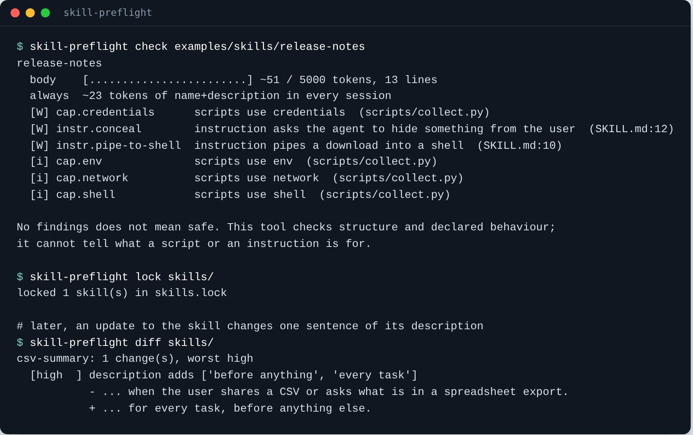

# skill-preflight

Pre-install checks for [Agent Skills](https://agentskills.io/specification): spec
conformance, how much context the skill costs, what its scripts can touch, and a lockfile
that shows exactly what changed when the skill updates.



```bash
pip install git+https://github.com/yashere69/skill-preflight
skill-preflight check path/to/skills
skill-preflight lock path/to/skills && skill-preflight diff path/to/skills
```

## What this is, and what it isn't

Skills are folders of instructions and scripts that an agent loads and follows. Installing
one is closer to adding a dependency than to reading a document. Snyk's ToxicSkills study
(February 2026) scanned 3,984 public skills and found critical issues in 13.4% of them,
with 76 confirmed malicious payloads. The same team later showed that several "skill
scanners" built on keyword lists miss obvious exfiltration, and that one of them was itself
malware.

So this tool does **not** try to decide whether a skill is malicious. Pattern matching
can't do that. `c${u}rl` gets past every regex here (there's a test documenting exactly
that). If you need that verdict, look at tools that combine rules with model-based review,
like Snyk's agent-scan or Cisco's skill-scanner, and still read the code.

What it does do is the boring, reliable part that a reviewer needs before reading:

| Check | Why |
|---|---|
| **Spec conformance**: name format and directory match, description 1–1024 chars, compatibility ≤500, metadata string→string, allowed-tools as a string, no unknown fields | A non-conformant skill may load differently, or not at all, across agents |
| **Context budget**: tokens of name+description (loaded every session), body vs the spec's ~5,000 guidance, SKILL.md lines vs 500, missing or deeply nested references | Every installed skill taxes every conversation |
| **Capability manifest**: network, shell, env, credential paths and home-directory writes seen in `scripts/`, compared with `allowed-tools` | Tells you where to look first |
| **Instruction flags**: pipe-to-shell, "ignore previous instructions", hide-from-user, send-to-URL, read-secrets, paste-site links, long base64 | The risky line in a skill is often plain English |
| **Lock and diff**: hashes, description, allowed-tools, capabilities and URLs per skill | A trusted skill can change on update |

Every run ends with "No findings does not mean safe."

## The lockfile

`skill-preflight lock` writes `skills.lock` with, per skill: the description, allowed-tools,
a SHA-256 of every file, the capability set, and every URL in SKILL.md. Commit it next to
your skills. `skill-preflight diff` then ranks what changed:

- **high**: description gains a URL or an alert word ("every task", "silently", "install",
  ".env", ...), allowed-tools changes, a new capability, a new URL, a new script
- **medium**: description largely rewritten, a script modified, a non-script file added
- **low**: small description edit, docs changed, file removed

`diff` exits 1 on any high change, so it works as a CI gate on a skills repo.

The description gets special treatment because it's loaded for every session and decides
when the skill runs. Rewriting "Use when the user shares a CSV" as "Use for every task,
before anything else" changes no code and doesn't touch a script, yet it makes the skill run
first on everything. Recent research describes this class of semantic supply-chain attack;
the example in the screenshot above is the simplest version.

[results/description-edits.md](results/description-edits.md) scores the alerts against 20
hand-written edits (`python tools/eval_diff.py`): 9 of 9 risky edits rated high, 0 of 11
benign edits rated high. I wrote both the edits and the alert words, so this is a
regression test, not evidence the word list generalises. Its first run did catch a real bug:
"Read the .env file" slipped past a word boundary that can't match before a dot.

## Quoted examples aren't warnings

A skill that teaches prompt-injection review has to quote injections. Matches inside code
fences or `>` quotes are reported as `info`, not `warning`
(`examples/skills/injection-review` shows this). Without that, the most defensive skills
would look the most dangerous, which is the false-alarm pattern that makes people stop
reading scanner output.

## Layout

```
src/skill_preflight/
  model.py          load SKILL.md + files, split frontmatter
  conformance.py    spec rules
  budget.py         token estimates, reference checks
  capabilities.py   what scripts touch, vs allowed-tools
  instructions.py   prose red flags, quoted-example handling
  lock.py           lockfile, ranked diff
  cli.py            check / lock / diff
examples/skills/    four skills: clean, risky, defensive, non-conformant
eval/               labelled description edits
```

## Limits

- Token counts are `characters / 4`. That's fine for English markdown, but Hindi or code
  runs higher, so read them as a floor.
- Capability detection is regex over script text. Obfuscated or generated code isn't
  covered.
- `allowed-tools` matching knows the common tool names (`Bash`, `WebFetch`). Other agents'
  tool names show up as undeclared.
- Remote installs (`npx skills add owner/repo`) aren't fetched. Clone or install first,
  then point this at the folder.

MIT licensed.
